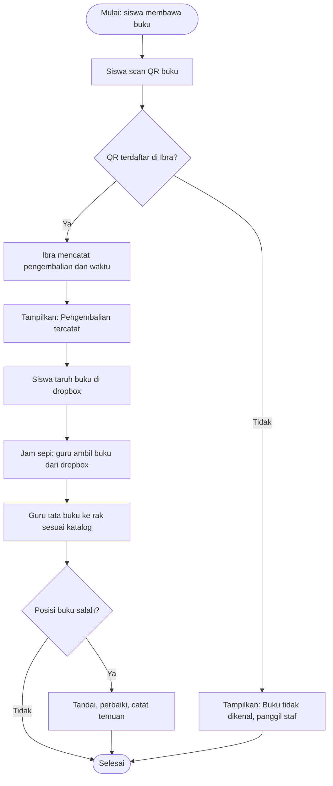

# D2 — System & Solution Design

**Project**: Digital Problem Framing Mini Project — Perpustakaan SD Muhammadiyah Nitikan
**Tim**: Yudo Rahman, Dafa Almer Dzaky, Ale Gunner Saprudin, Raffi Adien Saputra, Danish Al-Faiz | **Tanggal**: 12/11/2026 | **Versi**: v1.0
**Template**: TPL-02

> Worksheet terkait: WS05, WS06, WS07

---

## 1. Daftar Kebutuhan (User Story)

| # | User Story | Prioritas |
|---|---|---|
| 1 | Sebagai pengelola perpustakaan, saya ingin ruangan tetap rapi setelah sesi membaca, sehingga saya tidak kewalahan merapikan secara manual. | Tinggi |
| 2 | Sebagai staf perpustakaan, saya ingin setiap buku kembali ke posisi rak yang ditentukan, sehingga pengecekan akhir sesi berjalan cepat. | Tinggi |
| 3 | Sebagai staf perpustakaan, saya ingin mendorong lebih banyak siswa membaca, sehingga kunjungan ke perpustakaan lebih bermakna. | Sedang |
| 4 | Sebagai siswa, saya ingin mengembalikan buku sendiri dengan memindai QR buku lalu menaruhnya di dropbox, sehingga saya tidak perlu antre di meja staf dan staf tidak perlu menjaga saya satu per satu. | Tinggi |

## 2. Kriteria Penerimaan

| # | Kriteria Penerimaan (terukur & dapat diuji) |
|---|---|
| 1 | **Pengembalian tercatat.** Given buku memiliki QR yang terdaftar di Ibra, When siswa memindai QR dengan scanner, Then Ibra mencatat pengembalian beserta waktu dan menampilkan "Pengembalian tercatat" dalam < 5 detik. |
| 2 | **QR tidak dikenal.** Given QR tidak terdaftar di Ibra, When siswa memindainya, Then sistem menampilkan "Buku tidak dikenal", siswa diarahkan memanggil staf, dan tidak ada pengembalian yang tercatat. |
| 3 | **Skenario normal.** Given sesi membaca selesai, When buku dikembalikan dan checklist kerapian diisi, Then pengecekan akhir sesi selesai dalam ±10 menit. |
| 4 | **Skenario pengecualian.** Given ditemukan buku yang posisi raknya salah, When staf menandai dan memperbaikinya, Then buku ditandai di checklist, dikembalikan ke rak yang benar, dan temuan tercatat untuk evaluasi sesi berikutnya. |
| 5 | **Dropbox sesuai catatan.** Given akhir hari operasional, When guru mencocokkan isi dropbox dengan catatan pengembalian di Ibra, Then jumlah buku di dropbox sama dengan jumlah pengembalian yang tercatat (selisih 0). |
| 6 | **Data kunjungan tersedia.** Given sistem sudah dipakai selama satu hari, When pengelola membuka dashboard, Then jumlah kunjungan per hari dan jam paling ramai dapat dilihat. |

## 3. Success Metrics

| Metrik | Baseline (Sekarang) | Target | Cara Mengukur |
|---|---|---|---|
| Waktu transaksi peminjaman/pengembalian | 15 detik/orang | < 5 detik/orang | Stopwatch pada 10 transaksi saat uji prototipe, ambil rata-rata |
| Waktu rekap harian | 30–60 menit/malam | < 5 menit/malam | Catat durasi rekap harian oleh staf selama masa uji |
| Selisih pencatatan stok | 0,5%/bulan | < 0,1% | Cocokkan stok fisik dengan data Ibra di akhir bulan |
| Waktu pengecekan kerapian akhir sesi | Belum terukur | ±10 menit | Catat durasi pengisian checklist kerapian tiap sesi |
| Buku salah posisi | 11 kali/hari | Menurun dibanding baseline (angka target ditetapkan setelah uji prototipe) | Hitung temuan "salah posisi" pada checklist kerapian |

*Angka target adalah rencana dan akan divalidasi saat uji prototipe.*

## 4. Desain Solusi

### 4.1 Konsep Solusi (ringkasan)

Solusinya adalah pengembalian buku mandiri berbasis QR yang dibangun di atas aplikasi Ibra yang sudah dipakai perpustakaan. Siswa memindai QR buku dengan scanner, Ibra mencatat pengembalian secara otomatis, lalu siswa menaruh buku di dropbox dan langsung pergi. Guru mengambil buku dari dropbox saat jam sepi dan menatanya ke rak sesuai katalog. Dengan begitu pekerjaan merapikan dipindahkan dari jam padat (saat 3 staf kewalahan) ke jam sepi, dan perpustakaan tidak lagi terpakai sebagai tempat transit. Solusi ini memakai perangkat yang sudah dimiliki sekolah (komputer atau HP sebagai scanner) dan dropbox berupa kotak sederhana, tanpa penambahan staf, pengadaan perangkat baru, atau perubahan jam pulang siswa, sesuai batasan di D1.

### 4.2 Peta Komponen (IPO)

```
Input  ──▶  Proses  ──▶  Output
  │                           │
  └───── Data/Penyimpanan ────┘
```

- **Input**: kode QR buku dari hasil pindai scanner (HP/komputer sekolah); checklist kerapian dan penandaan buku salah posisi oleh guru/staf.
- **Proses**: mencocokkan kode QR dengan katalog di Ibra; mencatat pengembalian beserta waktu; menampilkan pesan "Pengembalian tercatat" atau "Buku tidak dikenal"; guru menata buku dari dropbox ke rak sesuai katalog saat jam sepi; menandai dan mencatat temuan jika posisi salah.
- **Output**: konfirmasi pengembalian untuk siswa; status buku terbarui di Ibra; checklist kerapian dan daftar temuan salah posisi; dashboard jumlah kunjungan, jam paling ramai, dan buku yang belum kembali.
- **Data/Penyimpanan**: basis data Ibra (katalog buku beserta posisi rak, transaksi pengembalian, data kunjungan) dan catatan temuan kerapian per sesi.

### 4.3 Flowchart & Pseudocode

*Simpan gambar flowchart di `assets/`. Kode Mermaid di bawah bisa dirender menjadi gambar.*



```
MULAI
  BACA kode_qr DARI scanner
  JIKA kode_qr terdaftar di Ibra MAKA
    CATAT pengembalian(buku, waktu)
    TAMPILKAN "Pengembalian tercatat"
    siswa TARUH buku DI dropbox
  JIKA TIDAK
    TAMPILKAN "Buku tidak dikenal"
    PANGGIL staf
  AKHIR JIKA

  // saat jam sepi
  UNTUK SETIAP buku DI dropbox
    guru TATA buku KE rak sesuai katalog
    JIKA posisi salah MAKA
      TANDAI dan CATAT temuan
SELESAI
```

## 5. Hasil Validasi Pemilik Usaha

- **Tanggal validasi**: [DD/MM/YYYY]
- **Feedback pemilik**: [isi setelah Ibu Yunistia Sekar Sarworini, S.I.P. meninjau alur scan–dropbox]
- **Perubahan setelah validasi**: [isi setelah validasi]

---

**Status**: ⬜ Draf → ⬜ Review Tim → ⬜ Validasi Pemilik → ⬜ Final (GATE 1)
